# ⚡ Awesome-Terminal-IDE-Collaborative-Coding 🚀

### 💻 Top Terminal IDE & Collaborative Coding Ecosystem 🌐

 

> **🎯 A curated directory of top SaaS platforms and open-source GitHub projects for Terminal IDEs, Real-Time Collaborative Code Editors, Cloud Development Environments (CDEs), and Remote Pair Programming.**

**📅 Last updated: November 2026**

---

## 📊 Sector Overview & Market Dynamics

The global **Cloud Development Environment (CDE)** and **Cloud IDE** sector is estimated at **$6.65 billion in 2026** (within a broader **$17.5 billion** global IDE software market), compounding at **~14.2% CAGR** toward an anticipated **$25 billion by 2035** 📈. The sector exhibits a **moderately fragmented, bifurcated market structure**: mega-cloud incumbents (Microsoft/GitHub Codespaces) dominate hosted enterprise workflows in a "winner-take-most" distribution for Git-native cloud workspaces, while rapid AI agent adoption and enterprise data-residency demands fuel a thriving, fragmented ecosystem of specialized collaborative editors (Zed, Replit, StackBlitz) and self-hosted open-source orchestrators (Coder, Daytona, DevPod) 🔄.

---

## 📑 Table of Contents

- [📊 Sector Overview & Market Dynamics](#-sector-overview--market-dynamics)
- [☁️ SaaS & Hosted Collaborative Platforms](#️-saas--hosted-collaborative-platforms)
- [🛠️ Open-Source GitHub Projects](#️-open-source-github-projects)
- [🧩 Frameworks for Building Custom Environments](#-frameworks-for-building-custom-environments)
- [⭐ Star History](#star-history)
- [💖 Support & Community](#-support--community)
- [🤝 How to Contribute](#-how-to-contribute)
- [⚠️ Disclaimer](#️-disclaimer)

---

## ☁️ SaaS & Hosted Collaborative Platforms

The table below catalogs leading commercial and hosted SaaS platforms for remote workspaces, cloud IDEs, and collaborative coding, sorted in **descending order by company scale (Revenue / Enterprise Valuation)** 🏢.

| Platform | Company Scale (Revenue / Valuation) | Starting Paid Tier Pricing | Free Tier / Free Trial Limits | Key Capabilities |
| :--- | :--- | :--- | :--- | :--- |
| **[VS Code Live Share](https://visualstudio.microsoft.com/services/live-share/)** | 🏢 **~$281.7B Annual Revenue** (Microsoft parent revenue; ~$3.6T Market Cap) | 💰 **Free forever** ($0 base service included with VS Code / Azure ecosystem) | 🎁 **Free forever plan**: Up to 5 concurrent guest collaborators per session by default (expandable up to 30 concurrent participants via configuration) with unlimited session durations and full terminal/port sharing | Instant real-time pair programming directly inside VS Code; bidirectional cursor tracking, shared terminals, and shared local server ports over secure P2P/relay channels. |
| **[GitHub Codespaces](https://github.com/features/codespaces)** | 🏢 **~$2.0B+ ARR** (GitHub subsidiary revenue run rate; owned by Microsoft) | 💰 **$0.18/hour** (for 2-core machines; ~$0.09/core-hour + $0.07/GB-month storage on consumption) | 🎁 **Free forever plan**: **60 hours/month** of runtime on 2-core compute (120 core hours) + **15 GB storage/month** for personal GitHub Free accounts (180 core hours / 20 GB for Pro) | Fully provisioned containerized cloud development environments inside browser or VS Code desktop with instant GitHub repo integration and `devcontainer.json` automation. |
| **[JetBrains Code With Me](https://www.jetbrains.com/code-with-me/)** | 🏢 **~$700M Annual Revenue** (~15.07B CZK; privately held bootstrap leader) | 💰 **$5.00/user/month** (Code With Me Premium stand-alone; or bundled free in all paid JetBrains IDE subscriptions) | 🎁 **Free Community plan**: Unlimited collaborative sessions capped at **30 minutes per session** and a maximum of **3 guest participants** | Deep pair-programming and collaborative development embedded natively in JetBrains IDEs (IntelliJ, PyCharm, WebStorm) with shared terminal execution, audio/video calls, and granular diff reviewing. |
| **[Replit](https://replit.com)** | 🏢 **~$9.0B Valuation** (Series D 2026; ~$150M ARR; $400M raised) | 💰 **$20.00/month** (Replit Core billed monthly; or $18/month billed annually at $204/yr) | 🎁 **Free Starter plan**: Includes basic workspace environment with 0.5 vCPU, 1 GB RAM, 10 GB storage, up to 3 public repls/projects, and standard community AI completion | Multiplayer browser-based cloud IDE featuring real-time collaborative concurrent editing, interactive bash terminal shells, instant public deployments, and autonomous AI agents. |
| **[StackBlitz](https://stackblitz.com)** | 🏢 **~$700M Valuation** (Series B 2025; ~$40M ARR; $135M+ funding) | 💰 **$18.00/user/month** (StackBlitz Pro billed annually; $25/month billed monthly) | 🎁 **Free Personal plan**: Unlimited public projects, public collections, and public GitHub repositories; capped at **1 MB file upload per project** and no private repository access | Instant zero-latency web IDE powered by WebContainers executing full Node.js runtimes and terminals securely inside browser WASM sandboxes. |
| **[Gitpod](https://www.gitpod.io)** | 🏢 **~$41M Total Funding** (~$4M ARR; valuation tripled in Series A) | 💰 **$20.00/month** (Core plan bundling monthly Ona Compute Units / pooled team compute credits) | 🎁 **Free tier**: **500 free credits/month** (equivalent to roughly 50 hours of standard workspace runtime on small compute classes) with up to 4 concurrent workspaces | Automated cloud development environments spinning up ephemeral, reproducible container workspaces from Git branches with automated prebuilds and multi-IDE support. |
| **[CodeSandbox](https://codesandbox.io)** | 🏢 **~$51M Valuation at Series A** ($15.2M total venture funding; acquired by Together AI) | 💰 **$18.00/editor/month** (Pro plan billed annually at $216/yr; $24/month billed monthly) | 🎁 **Free forever plan**: Up to 5 team members, **40 hours/month of microVM compute runtime**, and microVM hardware caps of up to 4 vCPUs and 8 GiB RAM | Full-stack cloud development sandboxes running on fast microVMs with live multiplayer pair programming, terminal access, Git branch previews, and iOS/web apps. |
| **[Floobits](https://floobits.com)** | 🏢 **~$150K Seed Funding** (Y Combinator S13 & FundersClub; private niche tool) | 💰 **$15.00/month** (Standard plan for private workspaces and encrypted collaboration) | 🎁 **Free plan**: Up to **5 concurrent workspaces**, strictly limited to public repositories and open workspaces with community terminal integration | Cross-editor real-time collaborative text and terminal editing with plugins for Vim, Emacs, Sublime Text, and Neovim over encrypted WebSockets. |

---

## 🛠️ Open-Source GitHub Projects

Curated open-source terminal-native IDEs, cloud IDE distributions, terminal multiplexers, and pair programming tools, sorted in **descending order by GitHub Stars_Count** ⭐.

- **[neovim/neovim](https://github.com/neovim/neovim)**   
  ⚡ Vim-fork focused on extensibility and usability, featuring built-in Lua scripting, asynchronous LSP integration, floating windows, and extensible peer-to-peer collaborative editing plugins.

- **[zed-industries/zed](https://github.com/zed-industries/zed)**   
  ⚡ High-performance, multiplayer-native code editor written in Rust with built-in real-time CRDT collaborative workspaces, integrated terminal sharing, voice channels, and Vim modal emulation.

- **[coder/code-server](https://github.com/coder/code-server)**   
  🌐 Run VS Code on any remote Linux/macOS server and access it securely through any modern web browser or terminal wrapper with extension marketplace support.

- **[daytonaio/daytona](https://github.com/daytonaio/daytona)**   
  🤖 Open-source development environment manager and infrastructure engine designed to spin up, orchestrate, and standardize secure workspaces for human developers and autonomous coding agents.

- **[termux/termux-app](https://github.com/termux/termux-app)**   
  📱 Powerful Android terminal emulator and Linux environment enabling full mobile terminal IDE setups with package management, Clang/Rust compilers, and SSH access.

- **[helix-editor/helix](https://github.com/helix-editor/helix)**   
  🦀 Post-modern modal terminal text editor written in Rust with built-in Tree-sitter syntax highlighting, multi-selection editing, and zero-config Language Server Protocol (LSP) integration.

- **[lapce/lapce](https://github.com/lapce/lapce)**   
  🚀 Lightning-fast, open-source code editor written in Rust featuring GPU-accelerated rendering, modal editing, built-in remote SSH execution, and WASM plugin support.

- **[zellij-org/zellij](https://github.com/zellij-org/zellij)**   
  🪟 A modern terminal workspace and multiplexer written in Rust featuring floating panes, tab layouts, WebAssembly plugins, and multi-user terminal session sharing.

- **[micro-editor/micro](https://github.com/micro-editor/micro)**   
  🖱️ Modern, intuitive terminal-based text editor with standard desktop keybindings (Ctrl+C, Ctrl+V, Ctrl+S), full mouse support, multi-cursor editing, and Lua plugin scripting.

- **[eclipse-theia/theia](https://github.com/eclipse-theia/theia)**   
  🏛️ Open-source platform and framework for building custom, vendor-neutral IDEs and tools for browser and desktop, compatible with the VS Code extension protocol and multi-user cloud workspaces.

- **[yudai/gotty](https://github.com/yudai/gotty)**   
  📡 Simple Go-based CLI tool that shares arbitrary terminal applications, shells, or tmux sessions as web-accessible applications over HTTP/WebSockets.

- **[coder/coder](https://github.com/coder/coder)**   
  🏢 Self-hosted enterprise cloud development environment platform using Terraform to provision remote workspaces across bare metal, Docker, Kubernetes, and public clouds.

- **[loft-sh/devpod](https://github.com/loft-sh/devpod)**   
  📦 Client-only, unopinionated open-source tool to spin up reproducible `devcontainer.json` environments on any cloud, Kubernetes cluster, or remote SSH host with zero vendor lock-in.

- **[tsl0922/ttyd](https://github.com/tsl0922/ttyd)**   
  🌐 Lightweight C-based command-line tool for sharing your terminal over the web via WebSockets with libuv and Xterm.js for high-throughput CLI collaboration.

- **[mawww/kakoune](https://github.com/mawww/kakoune)**   
  🎯 Modal terminal code editor implementing interactive selections and a client-server architecture that natively allows multiple terminal clients to edit the same file simultaneously.

- **[sinelaw/fresh](https://github.com/sinelaw/fresh)**   
  🌿 Modern, high-performance terminal IDE and text editor written in Rust with standard non-modal keybindings, LSP integration, multi-cursors, and Deno TypeScript plugins.

- **[gitpod-io/openvscode-server](https://github.com/gitpod-io/openvscode-server)**   
  🖥️ Upstream distribution of VS Code running as a remote server accessible through any modern web browser from any device, maintained for self-hosted container deployments.

- **[tmate-io/tmate](https://github.com/tmate-io/tmate)**   
  🤝 Instant terminal sharing fork of `tmux` engineered for secure peer-to-peer pairing over SSH or encrypted web links with read-write and read-only token controls.

- **[butlerx/wetty](https://github.com/butlerx/wetty)**   
  💻 Terminal-in-browser emulator over HTTP/HTTPS built with Node.js and WebSockets, enabling remote shell pair programming from lightweight web clients.

- **[jmacdonald/amp](https://github.com/jmacdonald/amp)**   
  ⚡ Lightweight modal text editor for the terminal written in Rust, inspired by Vi/Vim with built-in fuzzy file navigation, symbol jumping, and zero configuration required.

- **[curlpipe/ox](https://github.com/curlpipe/ox)**   
  🐂 Fast, customizable terminal text editor built in Rust featuring syntax highlighting, multi-cursor editing, split views, and Lua-based configuration.

- **[zenbu-labs/terminal-code](https://github.com/zenbu-labs/terminal-code)**   
  🖼️ Runs full VS Code directly inside modern GPU-accelerated terminal emulators using the Kitty graphics protocol and `code-server` with pane splitting and diff reviews.

- **[teamtype/teamtype](https://github.com/teamtype/teamtype)**   
  👥 Peer-to-peer, editor-agnostic collaborative editing daemon that enables developers to collaboratively edit local files across different editors simultaneously with live cursor sync.

- **[jbyuki/instant.nvim](https://github.com/jbyuki/instant.nvim)**   
  ⚡ Real-time collaborative editing plugin for Neovim written in Lua, providing built-in server/client synchronization, remote cursor rendering, and independent undo trees.

- **[owenthereal/upterm](https://github.com/owenthereal/upterm)**   
  🔒 Open-source instant terminal-sharing tool engineered for remote pair programming, allowing developers to share terminal sessions securely over SSH via Upterm public or self-hosted relays.

- **[sahilatahar/Code-Sync](https://github.com/sahilatahar/Code-Sync)**   
  💬 Real-time collaborative web code editor built with React, Socket.IO, and Docker featuring dynamic room generation, syntax highlighting, and live group chat.

- **[azratul/live-share.nvim](https://github.com/azratul/live-share.nvim)**   
  🤝 Real-time pair programming and collaborative editing plugin for Neovim inspired by VS Code Live Share, enabling live buffer synchronization across developers.

- **[termide/termide](https://github.com/termide/termide)**   
  🧰 All-in-one terminal workspace for desktops and servers: LSP-enabled editor, dual-pane SFTP/FTP file manager, terminal shell, Git client, database viewer, and coding agent in a static Rust binary.

- **[pairpad/pairpad](https://github.com/pairpad/pairpad)**   
  📝 Collaborative code annotation and pair programming tool designed to streamline developer onboarding through shared interactive walkthroughs.

---

## 🧩 Frameworks for Building Custom Environments

- 🚀 **Terminal Pair Programming Stack**: Run **[Neovim](https://github.com/neovim/neovim)** or **[Helix](https://github.com/helix-editor/helix)** inside **[tmate](https://github.com/tmate-io/tmate)** or **[Zellij](https://github.com/zellij-org/zellij)** for low-bandwidth, instantaneous terminal pair programming over SSH.
- ☁️ **Self-Hosted Enterprise Cloud IDE**: Combine **[Coder](https://github.com/coder/coder)** or **[Daytona](https://github.com/daytonaio/daytona)** + **[code-server](https://github.com/coder/code-server)** + **[DevPod](https://github.com/loft-sh/devpod)** to build a fully private, containerized cloud IDE platform backed by your own Kubernetes cluster or cloud VMs.
- ⚡ **P2P Multiplayer Modal Editing**: Install **[instant.nvim](https://github.com/jbyuki/instant.nvim)** or **[live-share.nvim](https://github.com/azratul/live-share.nvim)** inside Neovim for peer-to-peer collaborative editing without external cloud relays.

---

##  Star History
#

---

## 💖 Support & Community

Thank you so much for exploring and supporting **Awesome-Terminal-IDE-Collaborative-Coding**! 🙌

If you found this list helpful, please consider:
- ⭐ **Starring this repository** to help others discover it.
- 🍴 **Forking and sharing** it with your developer community, colleagues, and friends.
- ☕ **Buying a coffee or sponsoring ongoing open-source curation**: Visit the [GitHub Sponsors Dashboard](https://github.com/sponsors/ishandutta2007) to show your love and back future maintenance!

Your encouragement keeps this ecosystem thriving and up-to-date! 🚀

---

## 🤝 How to Contribute

1. 🍴 Fork this repository.
2. 📝 Add your tool, platform, or project to `README.md` in the appropriate section.
   - For SaaS products: provide company scale, exact starting pricing tier, specific free tier limits, and core capabilities.
   - For Open-Source projects: provide the repository link, Stars_Badge (`style=social&color=white`), and factual description.
3. 🔍 Keep entries factual, concise, and linked to official documentation or source repositories.
4. 🚀 Submit a Pull Request with a clear description of the addition.

---

## ⚠️ Disclaimer

- 📌 This repository is a community-curated list maintained for educational and reference purposes; inclusion does not imply official endorsement.
- 🔐 Terminal sharing utilities (`tmate`, `upterm`, `gotty`) and remote cloud IDEs grant shell execution permissions; always enforce SSH key authentication, password protection, and read-only permissions when sharing sessions with external collaborators.

---

**Made with ❤️ for terminal power users, remote engineering teams, pair programmers, and open-source developers.**

